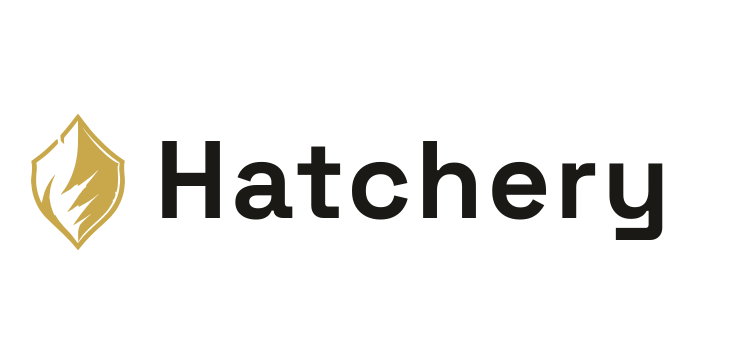

<br><br>
<picture>
  <source media="(prefers-color-scheme: dark)" srcset=".hatchery/branding/icons/hatchery-icon-dark.svg">
  
</picture>
<h1>Contributing</h1>
<br clear="both">

Thanks for your interest in contributing. Hatchery is a focused project and contributions are welcome - whether that's a bug fix, a new feature, documentation improvements, or just opening an issue with a thoughtful idea.

<br>

## Contents

- [Contents](#contents)
- [Ways to Contribute](#ways-to-contribute)
- [Before You Open a PR](#before-you-open-a-pr)
- [Controller vs Nest](#controller-vs-nest)
- [Development Setup](#development-setup)
- [Code & Style Guidelines](#code--style-guidelines)
- [Accessibility](#accessibility)
- [Commit Messages](#commit-messages)
- [Questions](#questions)

---

<br>

## Ways to Contribute

- **Bug reports** - something broken or behaving unexpectedly? Open an issue.
- **Feature requests** - have an idea that fits the project's direction? Open an issue and describe the use case.
- **Pull requests** - fixes, improvements, or new functionality. See the process below.
- **Documentation** - clearer explanations, better examples, or corrected typos are always appreciated.

---

<br>

## Before You Open a PR

1. **Check existing issues and PRs** to avoid duplicating work in progress.
2. **Open an issue first** for anything significant - a new provider, a change to the answer file schema, or a new provisioning target. This keeps effort aligned before code is written.
3. **Keep PRs focused.** One concern per pull request makes review faster and merging cleaner.
4. **Close the issue from the PR body.** Include a GitHub closing keyword for every issue the PR completes (for example `Closes #11`, or `Fixes` / `Resolves`). Referencing the number only in the title, branch, or commit is not enough - without a closing keyword, merge will not auto-close the issue.

---

<br>

## Controller vs Nest

| Plane | What you need |
|---|---|
| **Controller** | Python ≥3.11 + `uv` on Linux, macOS, or Windows. Portable CI and the default pytest suite run here. |
| **Local Nest** | Hypervisor tools for the **provider** you hatch with (`virsh` / Hyper-V / Tart / UTM). Only required when this machine is also the Nest. |
| **Remote Nest** | Enterprise (Nest Agent). Free HEAD is Local Nest only. |

High-level Controller × provider × guest summary: [README - What It Supports](README.md#what-it-supports). Living feature cells and quirk rows: [`docs/providers/`](docs/providers/). Nest = hardware, many Local providers: [ADR-0046](docs/adr/0046-nest-is-hardware-multi-provider.md).

When a PR changes provider capability, update `docs/providers/` and keep the README summary honest if the high-level story changed.

---

<br>

## Development Setup

Clone the repo and install dependencies with [uv](https://docs.astral.sh/uv/):

```bash
git clone https://github.com/dustinestes/Hatchery.git
cd Hatchery
uv sync
```

`uv sync` creates a virtual environment at `.venv` and installs all runtime and dev dependencies from `uv.lock`.

If you don't have `uv` installed:

```bash
curl -LsSf https://astral.sh/uv/install.sh | sh
```

**Controller only:** `uv sync` is enough to run the UI with an empty Nest registry (sandbox configs below).

**Local Nest (Linux + libvirt) example** - Nest-plane packages, not Controller requirements:

```bash
sudo apt install qemu-kvm libvirt-daemon-system virt-manager virtinst \
    swtpm swtpm-tools mtools
```

Windows Local Nest needs Hyper-V (and PowerShell) on that Nest; macOS Local Nest will need Tart and/or UTM when those providers land. Full inventory: [#271](https://github.com/dustinestes/Hatchery/issues/271).

**Run the app:**

```bash
# Preferred: see docs/cli/ - session-only --data-dir never writes Settings
uv run hatchery serve --host 127.0.0.1 --port 5000
# Optional sandbox data root (empty Nest registry):
# uv run hatchery serve --data-dir .temp/hatchery-sandbox --host 127.0.0.1 --port 5001
# Same sandbox with this Controller registered as Local Nest:
# uv run hatchery serve --data-dir .temp/hatchery-sandbox-local --nest-local --host 127.0.0.1 --port 5002

# Equivalent contributor path (same app object):
uv run gunicorn hatchery:app --bind 127.0.0.1:5000 --workers 1
# Session data dir for gunicorn: HATCHERY_DATA_DIR=/path/to/sandbox uv run gunicorn ...
# http://localhost:5000
```

**Run and Debug (Cursor / VS Code):** use the configs in [`.vscode/launch.json`](.vscode/launch.json) (#337):

| Config | Data dir | Nest registry | Port |
|---|---|---|---|
| **Hatchery: production** | Normal Controller `data_dir` (no override) | Whatever this machine already has | `5000` |
| **Hatchery: sandbox** | `${workspaceFolder}/.temp/hatchery-sandbox` | Empty (Controller-only) | `5001` |
| **Hatchery: sandbox (Local Nest)** | `${workspaceFolder}/.temp/hatchery-sandbox-local` | Registers Local via `--nest-local` if missing | `5002` |

Sandbox dirs live under `.temp/` (already gitignored as Hatchery runtime artifacts). They do not rewrite Settings or the production data dir. Delete a sandbox folder to reset it.

### A note on devcontainers

Hatchery does not ship devcontainer configurations. A **Local Nest** needs direct access to Nest hypervisor tools (for example libvirt’s `virsh` / `virt-install` / `qemu-img` on Linux). A container cannot reach those Nest-level services without privileged setup that adds complexity for little gain. Run the Controller (and Local Nest, when used) directly on the machine.

---

<br>

## Code & Style Guidelines

- **Python** - formatted and linted with `ruff`. Run `uv run ruff check . && uv run ruff format --check .` before pushing.
- **Tests** - `uv run pytest` locally. CI runs the portable suite on **Linux, macOS, and Windows** (see [`docs/tests.md`](docs/tests.md)). Do not add host-only assumptions that break another OS. Real Nest/hypervisor tests use `@pytest.mark.hypervisor` and are skipped in CI.
- **Line length** - 100 characters.
- **HTML/CSS/JS** - follow the existing patterns in `templates/ui/` and `static/`. No frameworks.
- **Providers** - new hypervisor integrations go in `lib/providers/` and implement the interface in `base.py`. Don't add methods to the interface unless the feature genuinely requires it. Update [`docs/providers/`](docs/providers/) when capability changes.
- **Answer files** - user-owned templates under `automation/answerfiles/` (optional Library pull). New guest OS types get Library/sample Answer Files plus hatch validation in `lib/answerfile.py`; Nest attach stays in the provider.
- **Comments** - write one only when the *why* is non-obvious. Don't describe what the code does.

---

<br>

## Accessibility

Inclusive UI is a **standing expectation**, not a follow-up cleanup pass. A broader accessibility investment is tracked under [#161](https://github.com/dustinestes/Hatchery/issues/161); until then, do not regress the basics when you touch the UI.

- **Labels first** - panes and controls should expose clear text names. The collapsed icon rail is an opt-in density mode for people who already know the app; it is not a substitute for readable navigation. Icon-only states still need accessible names (`aria-label` / `title`).
- **Keyboard** - primary flows must work without a pointer. Keep focus visible; interactive custom widgets (trays, flyouts, toggles) should support Escape / Enter in line with existing patterns.
- **Don’t rely on color alone** - hatch/script status and alerts need text (or another non-color cue), not only badge color.
- **Dynamic UI** - toasts, trays, and live regions should remain understandable to assistive tech (sensible roles, labels, and updates - don’t invent a parallel design system).
- **Motion** - prefer respecting `prefers-reduced-motion` when adding transitions.
- **Page title** - the current pane name lives in the topbar (`#topbar-page-title`), driven by `active_pane` via [`lib/ui_chrome.py`](lib/ui_chrome.py). Do not reintroduce per-pane h1 + subtitle chrome. New panes: set `active_pane` and add a label to `PANE_TITLES` (or rely on the humanize fallback); use optional `page_title` only when the sidebar id must stay a parent group (e.g. Build/Edit under Clutches).

When in doubt, favor the labeled, keyboard-reachable control over a mouse-only shortcut.


---

<br>

## Commit Messages

Use a conventional commit prefix followed by a short, present-tense description:

```
feat: add snapshot list to manage page
fix: resolve virsh timeout on slow hosts
docs: update getting-started with VirtIO setup
chore: pin ruff version in pyproject.toml
breaking: rename /api/status to /api/nest-status
```

| Prefix | When to use |
|---|---|
| `feat:` | New feature or user-facing change |
| `fix:` | Bug fix |
| `docs:` | Documentation changes only |
| `chore:` | Maintenance, tooling, or non-functional changes |
| `refactor:` | Code restructure with no behavior change |
| `sec:` | Security fix or audit finding |
| `breaking:` | Change that breaks backwards compatibility |

---

<br>

## Questions

Open an issue and tag it `question`. There's no wrong question here.

<br>

---

<picture>
  <source media="(prefers-color-scheme: dark)" srcset=".hatchery/branding/logos/hatchery-logo-dark.svg">
  
</picture>
<div align="right">Hatch. Provision. Scale.</div>
<br clear="both">
