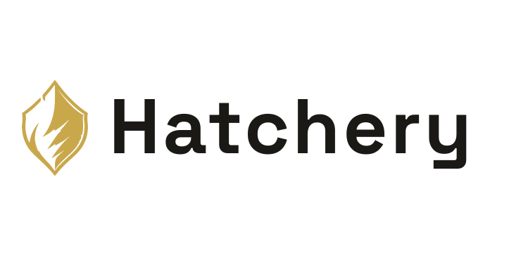
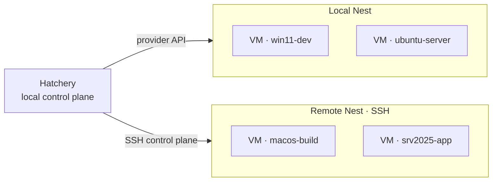

<br/><br/>

<div align="center">

<br/>

<picture>
  <source media="(prefers-color-scheme: dark)" srcset=".hatchery/branding/logos/hatchery-logo-dark.svg">
  
</picture>

<p><strong>Hatch. Provision. Scale.</strong></p>

<br/>


<br/>

</div>

<br/><br/>

---

Hatchery is a local web application for creating, provisioning, and managing VMs on local and remote Nests. Point it at source media, fill in a form, and get a fully provisioned VM without touching a terminal.

---

<br/>

## What It Does

- **Hatch** - create guest VMs from source media using unattended install methods on local and remote hosts
- **Provision** - runs defined script automations on the new guest to baseline the configuration
- **Scale** - operate one local Nest or many remote Nests from a single control plane
- **Library** - pull Clutches, scripts, and media from shares, forges, and API catalogs into a local-first cache
- **Manage** - start, stop, destroy, snapshot, and restore from a browser UI
- **Observe** - monitor Hatchery, Nests (local and remote), and individual VMs
- **Notify** - alerting, event tracking, and auditing across the fleet

---

<br/>

## Library connections

Connections are named endpoints (base URI + optional token); **bindings** attach a connection + filter results to Scripts, Clutches, or Media..

| Type | What it reaches | List / pull |
|---|---|---|
| **Path / share** | Local directory or mounted NAS | Recursive glob |
| **HTTPS** | Static HTTP(S) base | Explicit relative file path(s) in the binding filter |
| **Git** | Forge or local repo (shallow clone cache) | Path glob on the default branch |
| **API** | Catalog backends via **provider plugins** | Provider-specific filter (first: **Artifactory** - `repoKey[/path/glob]`) |

---

<br/>

## What It's Made Of

### Architecture



One Hatchery instance on your workstation drives a local Nest and any number of remote Nests over SSH. Hatch, provision, and lifecycle actions run against whichever Nest you choose. The same UI covers a local host and remote hosts across the network.

### Stack

| Piece | Role |
|---|---|
| **Python ≥3.11** + **uv** | Runtime and dependency management |
| **Flask** + **Gunicorn** | Local web app and API |
| **Jinja2** + vanilla **HTML/CSS/JS** | UI pages and unattended-install templates (no JS framework) |
| **SQLite** | App state: hatch sessions, events, alerts, settings |
| **YAML** + **Pydantic** | Clutch blueprints and validated config |
| **libvirt / KVM / QEMU** | Nest provider for Linux hosts: create, lifecycle, and snapshots |
| **OpenSSH** | Nest control plane to remote hosts |
| **Answer files** + **WinRM** | Unattended guest install, then scripted baseline provisioning |

<br>

> Layout and module map → [Project Structure](docs/project-structure.md)

---

<br/>

## What It Supports

**Controller** runs on Linux, macOS, and Windows. A **Nest** is the hardware that holds guests; **providers** (libvirt, Hyper-V, Tart, UTM) are adapters on that Nest ([ADR-0046](docs/adr/0046-nest-is-hardware-multi-provider.md)). Free edition is **Local Nest** only; Remote Nest is Enterprise.

### Controller × Local Nest provider

| Controller OS | Local Nest providers | Free status |
|---|---|---|
| Linux | libvirt (KVM/QEMU) | **Works** (reference path) |
| Windows | Hyper-V | **Works** for hatch / lifecycle; guest WinRM provision still filling in |
| macOS | Tart, UTM | **Planned** ([#627](https://github.com/dustinestes/Hatchery/issues/627), [#210](https://github.com/dustinestes/Hatchery/issues/210)) |

One Local Nest machine may expose every Local provider that works there (not “one hypervisor seat”).

### Guest family × Local provider

| Guest family | libvirt local | Hyper-V local | Tart local | UTM local |
|---|---|---|---|---|
| Windows 10 / 11 / Server 2022 / 2025 | **Works** (UEFI + TPM where required) | **Works** hatch; provision **Planned** | **Planned** | **Planned** |
| Linux | **Planned** | **Planned** | N/A | **Planned** |
| macOS | N/A | N/A | **Planned** | **Planned** |

### Known quirk cells (document as they land)

| Quirk | Provider | Tracking |
|---|---|---|
| Win11 black-screen hang after install reboot | libvirt local | [#141](https://github.com/dustinestes/Hatchery/issues/141) |
| Boot-from-CD key timing after Nest package upgrades | libvirt local | [#171](https://github.com/dustinestes/Hatchery/issues/171) |

<br>

> Living Nest × feature matrix (lifecycle, install, control plane) → [Provider support matrix](docs/providers.md)

---

<br/>

## Remote Nest

Free Hatchery is **Local Nest** only on this Controller. Remote Nest hierarchy is Hatchery Enterprise (Nest Agent) - see [Enterprise docs](docs/enterprise/README.md) and [ADR-0044](docs/adr/0044-free-head-local-nest-only.md).

Guest remoting (SSH/WinRM to known guest VMs) remains free - [guest transport](docs/guest-transport.md).

---

<br/>

## What It Requires

| Layer | Requirement | Notes |
|---|---|---|
| **Controller** | Python ≥3.11 on Linux, macOS, or Windows | UI / CLI; no Nest hypervisor packages required to start empty |
| **Local Nest** | Provider tools on this machine | Only when this Controller also hatches guests; see matrix above |
| **Media** | Guest ISO(s); optional VirtIO ISO | Your own eval or licensed copies |

Linux Local Nest (libvirt) example:

```bash
sudo apt install qemu-kvm libvirt-daemon-system virt-manager virtinst \
    libguestfs-tools swtpm swtpm-tools python3
```
`swtpm` / `swtpm-tools` are needed on the Nest for Win11 / Server 2025 UEFI + TPM. Full Controller vs Nest inventory: [#271](https://github.com/dustinestes/Hatchery/issues/271) and [Contributing](CONTRIBUTING.md).

---

<br/>

## Where To Start

1. **Install host dependencies** - see requirements above
2. **Clone and install Python deps** - `uv sync`
3. **Run Hatchery** - `uv run hatchery serve --host 127.0.0.1 --port 5000` (or `uv run gunicorn hatchery:app --bind 127.0.0.1:5000 --workers 1`)
   > To run as a background service that starts automatically, see [Running as a Service](docs/getting-started.md#running-as-a-service).
4. **Open the dashboard** - `http://localhost:5000`
5. **Hatch a VM** - go to `/create`, fill in the form, click Hatch

<br>

> Getting Started → [Getting Started Guide](docs/getting-started.md)

---

<br/>

## What's Planned Next

- **Planned and in-progress** → [GitHub Issues](https://github.com/dustin-estes/hatchery/issues)
- **Shipped by version** → [GitHub Releases](https://github.com/dustin-estes/hatchery/releases)

---

<br/>

## How to Contribute

Contributions, ideas, and feedback are welcome. See [CONTRIBUTING.md](CONTRIBUTING.md) for guidelines.

---

<br/>

## How It's Licensed

MIT License. See [LICENSE](LICENSE) for full terms.

---

<br/>

## With Thanks To

- **Dustin Estes** - creator, product design, and development

<br>

---

<picture>
  <source media="(prefers-color-scheme: dark)" srcset=".hatchery/branding/logos/hatchery-logo-dark.svg">
  
</picture>
<div align="right">Hatch. Provision. Scale.</div>
<br clear="both">
